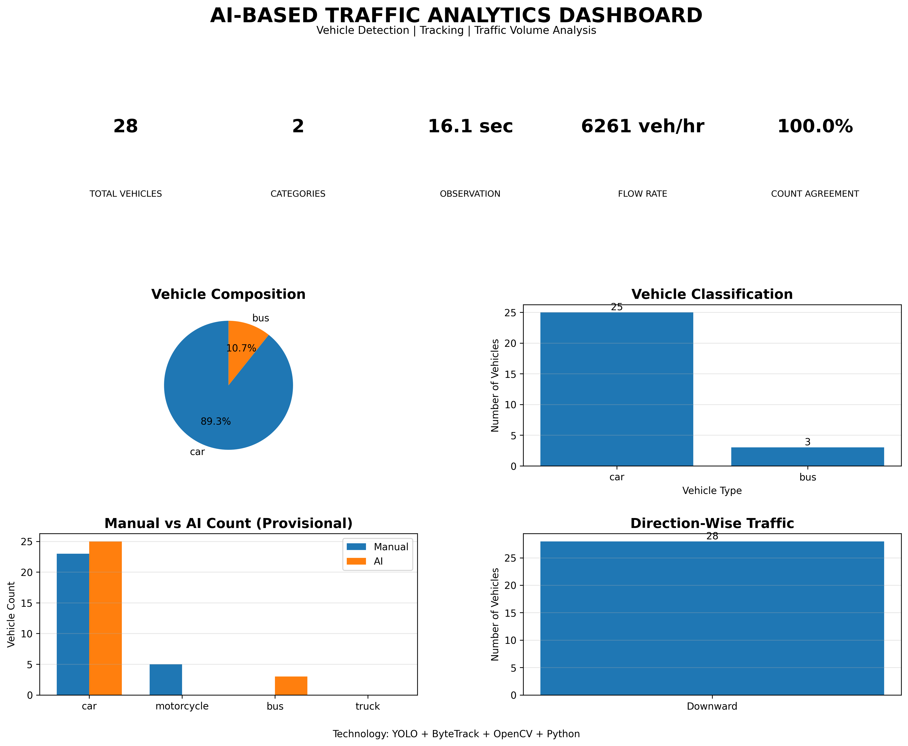

## Traffic Analytics Dashboard

The dashboard presents the preliminary results of the vehicle detection and traffic volume analysis.

### Key Results

- Total AI-recorded vehicle crossings: 29
- Cars: 25
- Buses: 4
- Observed traffic flow: 1.805 vehicles/second

*Note: Results are preliminary and have not yet been independently validated against manual counts.*
## Methodology

The project follows a computer vision-based traffic monitoring pipeline.

1. **Video Input:** Traffic footage is uploaded into Google Colab.
2. **Frame Processing:** OpenCV extracts individual frames from the video.
3. **Vehicle Detection:** YOLO11n detects vehicles and generates bounding boxes.
4. **Vehicle Classification:** Detected vehicles are classified into cars, motorcycles, buses and trucks.
5. **Object Tracking:** ByteTrack associates vehicle detections across successive frames using tracking IDs.
6. **Virtual Counting Line:** A predefined horizontal line is used to identify vehicle crossings.
7. **Event Recording:** Vehicle IDs, predicted categories, crossing times and directions are recorded.
8. **Traffic Analysis:** Pandas processes the event dataset, while Matplotlib generates the analytics dashboard.
